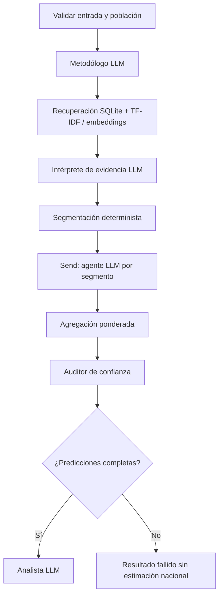

# GenAI Mavericks · Fase 2

MVP de simulación distribucional de adultos de España: LangGraph, agentes por segmento, evidencia trazable, agregación ponderada y auditoría metodológica. Las ejecuciones Mock y las fixtures se identifican como **DEMO / SYNTHETIC** y no tienen validez sociológica.

## Arranque con uv

Requiere Python 3.11+ y [uv](https://docs.astral.sh/uv/). `uv sync` crea `.venv` e instala las versiones reproducibles de `uv.lock`. El entorno creado durante la implementación usa Python 3.13.

Windows PowerShell y Linux/macOS:

```sh
uv sync
uv run python main.py create-demo
uv run python main.py simulate --provider mock --question "¿Pagarías por una aplicación con IA?" --options "Sí" "No" "No estoy seguro" --segments 5 --output outputs/demo.json
uv run streamlit run app.py
uv run pytest -q
uv run ruff check src tests app.py main.py
```

No es necesario activar el entorno al usar `uv run`. Activación manual opcional:

```powershell
.\.venv\Scripts\Activate.ps1
```

```sh
source .venv/bin/activate
```

Copia `.env.example` a `.env` (`Copy-Item .env.example .env` en PowerShell; `cp .env.example .env` en Linux). No incluyas credenciales en git. El proveedor predeterminado es Ollama; el modo demo siempre se solicita explícitamente.

## Ollama

Ollama no estaba instalado en el PATH ni accesible durante el desarrollo. No se han descargado modelos. Instala Ollama y elige un modelo compatible con tu memoria. GPU y rendimiento no verificados.

```sh
ollama serve
ollama pull qwen3:8b
ollama list
uv run python main.py check-model --model qwen3:8b
uv run python main.py simulate --provider ollama --model qwen3:8b --path data/raw/synthetic_population_sample.parquet --question "¿Pagarías por una aplicación con IA?" --options "Sí" "No" "No estoy seguro" --segments 5
```

Alternativa de menor tamaño: configura `OLLAMA_MODEL=gemma3:4b` y descarga solo ese modelo. Concurrencia inicial 1; aumenta mediante `--concurrency 2` o `LLM_MAX_CONCURRENCY`. Timeout por llamada, límite total, reintentos, validación contextual, caché en `outputs/cache` y registros de latencia. `reasoning=False` solicita respuestas sin razonamiento para Ollama. Comprueba compatibilidad al cambiar de modelo. No se cambia a Mock si falla Ollama.

API externa compatible con OpenAI: `uv sync --extra external`, configura `LLM_PROVIDER=external`, `EXTERNAL_MODEL`, `EXTERNAL_BASE_URL`, `EXTERNAL_API_KEY`. No se ha probado con una API real. `LLMProvider` permite implementar otros proveedores.

## CLI

```sh
uv run python main.py inspect-population --path data/fixtures/population.csv
uv run python main.py build-segments --path data/fixtures/population.csv --segments 24 --output outputs/segments.json
uv run python main.py ingest-surveys --path data/fixtures/evidence.json
uv run python main.py search-evidence --query "inteligencia artificial"
uv run python main.py simulate --provider mock --rag off --question "¿Usas IA?" --options "Sí" "No" --segments 5
uv run python main.py backtest --provider mock --cases data/fixtures/backtest_cases.json
```

Las salidas de `simulate` se guardan en `outputs/<simulation_id>.json`, con pregunta, modelo, población, evidencia, predicciones, advertencias, etapas, cobertura, fecha UTC y duración. Código de salida 2 si faltan segmentos; 1 ante error de entrada/proveedor. Los resultados nacionales se omiten si hay fallos. Las opciones se conservan literalmente como claves.

## Flujo y módulos



- `src/mavericks/population.py`: carga CSV/Parquet, metadatos, validación y perfiles ponderados.
- `schemas.py`: contratos Pydantic y configuración de entorno.
- `llm.py`: protocolo, Mock, Ollama/API externa, structured output, reintentos y caché.
- `evidence.py`: ingesta idempotente, SQLite, recuperación híbrida, índice semántico opcional y estadísticas CIS.
- `graph.py`: StateGraph, estado tipado, Send y reducer que rechaza duplicados.
- `statistics.py`: agregación, subgrupos, MAE, JSD, auditor e intervalos experimentales.
- `evaluation.py`: backtesting con exclusiones, corte temporal y persistencia.
- `cli.py`, `main.py`, `app.py`: CLI e interfaz Streamlit.

Las poblaciones completas permanecen fuera del estado. Cada segmento conserva distribuciones internas ponderadas y hasta tres perfiles ilustrativos sin `person_id`. Se reduce resolución retirando dimensiones completas si se supera el máximo de segmentos: por eso `--segments 5` puede producir 3, no exactamente 5. Solo se publican subgrupos distinguibles con las dimensiones retenidas. No se inventan diferencias autonómicas.

## Evidencia y microdatos

Consulta [docs/phase1-contract.md](docs/phase1-contract.md) antes de conectar la Fase 1. `Accenture.md` y los datasets reales no estaban presentes; se usa un contrato provisional explícito, sin inferir categorías ni joins.

```sh
uv run python main.py ingest-surveys --path data/raw/cis_questions.parquet --respondents data/raw/cis_respondents.parquet --responses data/raw/cis_responses.parquet --answer-column answer --weight peso
uv run python main.py survey-stats --respondents data/raw/cis_respondents.parquet --responses data/raw/cis_responses.parquet --question-uid CIS3546_P1 --weight peso --group-by grupo_edad --output outputs/cis_stats.json
```

Se calculan estadísticas en Python y se adjuntan a cada evidencia antes del RAG; nunca se calculan porcentajes leyendo tablas con el LLM. Los joins exigen `(estudio_id, respondent_uid)`. `peso_ccaa` solo se utiliza si se solicita explícitamente. NS/NC se mantiene. Respuesta múltiple exige una fila por opción/entrevistado y `selected` booleano, incluidos ceros; el denominador cuenta personas una vez.

Formatos: CSV, Parquet, JSON, XLSX y PDF con texto extraíble. PDFs sin texto se marcan `requires_ocr`; no se ejecuta OCR. SAV opcional: `uv sync --extra spss` (no instalado ni verificado). Ficheros antiguos XLS requieren un motor adicional, no incluido.

Por defecto la búsqueda combina TF-IDF con metadatos de tema, fecha, universo y opciones. El score es de **recuperación**, no confianza predictiva. Embeddings multilingües/Chroma: `uv sync --extra semantic`, configura `EMBEDDING_MODEL_PATH` a un modelo local previamente obtenido (p. ej. multilingual MiniLM) y `CHROMA_PATH`; vuelve a ingerir para indexarlo. No se descarga ningún modelo automáticamente. Esta ruta está implementada, pero no se ha ejecutado con un modelo real. Los filtros de backtesting se aplican antes de combinar candidatos, también cuando hay índice semántico.

## Fiabilidad y límites

El auditor separa calidad de evidencia, estabilidad y exactitud histórica. Devuelve **«Fiabilidad predictiva todavía no calibrada»**; no inventa Trust Score, precisión ni intervalos. MAE y Jensen-Shannon están probados con fixtures. El backtesting excluye IDs, textos duplicados, familias equivalentes declaradas y evidencia posterior al corte temporal; fechas desconocidas se excluyen en pruebas temporales. Es necesario revisar equivalencias humanas: no se garantiza identificar toda paráfrasis. Tampoco se controla que el preentrenamiento contenga preguntas históricas.

`calibrated_intervals` es una utilidad experimental con errores históricos externos y mínimo de 20 casos; no se conecta automáticamente al auditor y no constituye garantía bajo cambio de dominio. El auditor no mide estabilidad a partir de una única ejecución. Las narrativas son interpretaciones sintéticas; las cifras autoritativas están separadas en el JSON. Los LLM pueden cometer errores interpretativos incluso con salidas estructuradas.

Ver [docs/status.md](docs/status.md) para el estado y verificaciones. Próximos pasos: adaptar al `Accenture.md` definitivo, cargar datos reales, probar Ollama con 3-5 segmentos, revisar evidencia, y después ejecutar validación histórica por tema y segmento. La interfaz para un futuro focus group puede consumir el informe de simulación; no se implementan conversaciones ni testimonios sintéticos en esta fase.

Referencias de API consultadas: [LangGraph Send](https://reference.langchain.com/python/langgraph/types/Send), [ChatOllama structured output](https://reference.langchain.com/python/langchain-ollama/chat_models/ChatOllama/with_structured_output).
