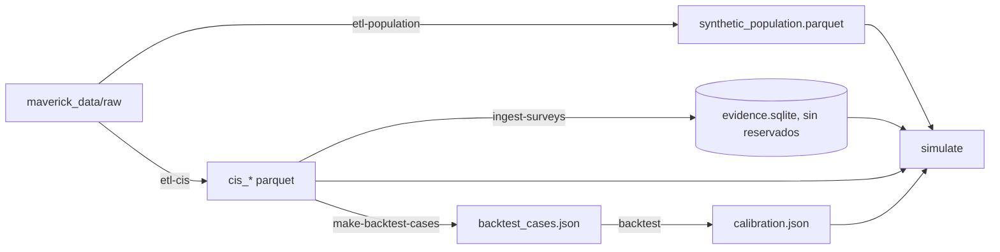
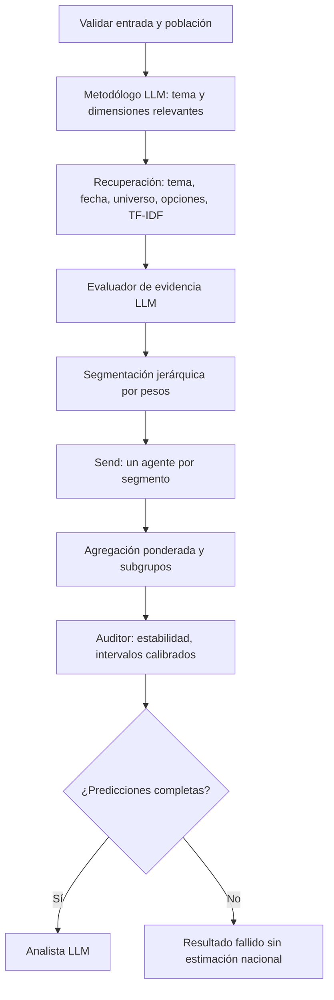

# GenAI Mavericks · población sintética de España con agentes LLM

Simulación distribucional de adultos residentes en España: una población sintética (Fase 1) se segmenta por peso, cada
segmento recibe una estimación anclada en los microdatos reales del CIS y un grafo de LangGraph agrega el resultado
nacional y por subgrupos junto con una estimación de cuánto fiarse. Las ejecuciones con Mock y las fixtures se
identifican como **DEMO / SYNTHETIC** y no tienen validez sociológica.

## Flujo de trabajo



Los datos **no se suben a git**: `maverick_data/` y `data/processed/` están ignorados (solo `catalogo.csv` y
`README.md` de `maverick_data/`). Reglas del reto: ningún dato publicado después del 30/06/2026 y los estudios con
`reservado_examen = si` (publicados desde el 01/04/2026) no se usan para desarrollar ni para el RAG, solo para el
backtest.

## Arranque

Requiere Python 3.11+ y [uv](https://docs.astral.sh/uv/) (`pip install uv`; si hay un error de certificado TLS al
descargar Python o paquetes, `UV_SYSTEM_CERTS=1`; en PowerShell `$env:UV_SYSTEM_CERTS = "1"`). Si tras `pip install uv` el comando
`uv` no está en el PATH, usa `python -m uv ...` en todos los comandos de abajo.

```sh
uv sync --extra embed      # --extra embed: sentence-transformers para e5 (prior aprendido); sin él la demo usa solo el KNN
uv run pytest -q           # 326 tests (12 necesitan los datos reales y se omiten sin ellos)
uv run ruff check src tests app.py main.py
```

### Primera instalación completa (probada en un clon limpio)

Los datos no están en git: coloca los microdatos en `maverick_data/raw/` (la carpeta con `consumo/`, `general/`, `ia_tecnologia/`, `medio_ambiente/`, `salud/`, `soledad/`,
`vivienda/`) y descarga una vez el modelo e5 (`uv run python -c "from sentence_transformers import SentenceTransformer as S; S('intfloat/multilingual-e5-base')"`; se necesita
internet solo esta vez, la demo lo carga después con `local_files_only`). Después, en este orden (tiempos medidos en un portátil con 8 núcleos, sin GPU):

```sh
uv run python main.py etl-population --n 50000 --seed 42                    # 1,7 min
uv run python main.py etl-cis                                               # 6,5 min
uv run python main.py ingest-surveys --path data/processed/cis_questions.parquet                    # 9 s  (almacén v1, respaldo si falta el v2)
uv run python main.py build-national                                        # 36 s
uv run python main.py etl-external                                          # 3 min  (Eurobarómetro y ESS, solo España)
uv run python main.py ingest-surveys --path data/processed/cis_questions.parquet --db data/processed_v2/evidence_v2.sqlite   # 9 s
uv run python main.py ingest-surveys --path data/processed_v2/external_evidence.json --db data/processed_v2/evidence_v2.sqlite  # 4 s
uv run python main.py make-backtest-cases                                   # 13 s  (88 casos oficiales)
uv run python main.py make-backtest-cases --split dev --topics salud soledad medio_ambiente ia_tecnologia vivienda \
  --since 2024-09-01 --max-per-study 5 --out data/processed_v2/backtest_cases_dev.json                # 29 s  (casos de desarrollo)
uv run python main.py population-targets                                    # 3 s
uv run python main.py train-prior                                           # crea la caché de embeddings e5 y entrena el MLP del prior (outputs/models)
uv run python main.py fast-validation                                       # 2,5 min  (rangos y tabla de la página Validación)
uv run python main.py build-examples                                        # 30 s  (ejemplos precalculados de la barra lateral)
uv run streamlit run app.py
```

Sin los pasos de `fast-validation` y `train-prior` la app arranca igualmente, pero solo con el KNN y sin rangos probables («Sin calibración suficiente»). `calibrate-prior`
(rangos y tabla del prior) necesita además las predicciones de las validaciones de investigación (`python -m mavericks.prior_v2.bigdev`, `confirm` y `confirm2`, horas de CPU) y es opcional.
Para el modo con LLM instala [Ollama](https://ollama.com) y `ollama pull qwen3:8b`; para el modo ajustado, ver «Modo ajustado» más abajo.

Demo sin datos reales (todo marcado como sintético):

```sh
uv run python main.py create-demo
uv run python main.py simulate --provider mock --question "¿Pagarías por una aplicación con IA?" --options "Sí" "No" "No estoy seguro" --segments 5
uv run streamlit run app.py
```

## Datos y modelo

La app necesita archivos que **no están en git** (inventario con tamaños y fuentes en [docs/datos.md](docs/datos.md)). Tres caminos:

**A. Descargarlos (lo más rápido, ≈ 2 minutos).** Los repositorios de Hugging Face son **privados**: pide acceso a `JaviPica` y entra con tu cuenta.

```sh
uv sync --extra embed --extra hub
uv run hf auth login                      # token con permiso de lectura (se guarda en tu usuario, no en el proyecto)
uv run mavericks fetch-assets             # dataset JaviPica/mavericks-assets: zip de 43 MB (82 MB descomprimido); verifica los sha256 del manifest
uv run mavericks fetch-adapter            # solo modo ajustado: modelo JaviPica/mavericks-qwen3-4b-cis (63 MB) -> outputs/ft/runs/b1/adapter_final, sha256 f6a4dd94...
uv run streamlit run app.py
```

Medido en un clon limpio: `fetch-assets` 47 s, `fetch-adapter` 12 s, y los 275 tests pasan con los archivos descargados (el aviso de «symlinks» de Hugging Face en Windows es inofensivo). `fetch-assets --from ruta/mavericks_assets_v1.zip` usa un zip local (sin internet). El paquete contiene solo agregados y datos procesados (población sintética, microdatos procesados del CIS de estudios **no reservados**,
almacén de evidencia, modelo del prior y resultados de validación); no incluye `maverick_data/` ni los ficheros originales del Eurobarómetro o la ESS. Quien mantiene el paquete lo regenera con `uv run mavericks pack-assets`.
El modo con LLM necesita además Ollama, y el ajustado el entorno `.venv_ft`, la base Qwen y `scripts\run_server.ps1` (ver «Modo ajustado»).

**B. Regenerarlo todo desde los datos originales.** Descarga `maverick_data/raw` del Google Drive del equipo (6,6 GB, no se redistribuye) y ejecuta los comandos de «Primera instalación completa» (≈ 20 minutos
más la caché de embeddings). Es el camino de referencia para auditar de dónde sale cada archivo.

**C. Demo sintética sin datos.** `uv run python main.py create-demo` y `uv run streamlit run app.py` (todo marcado como DEMO / SYNTHETIC, sin validez sociológica).

## Pipeline con datos reales

```sh
# 1. Población (Censo 2021 + Cifras de Población + EPA 2T26 + ECV 2025), n y semilla configurables
uv run python main.py etl-population --n 50000 --seed 42
# 2. Microdatos del CIS -> cis_studies / cis_questions / cis_respondents / cis_responses
uv run python main.py etl-cis
# 3. Evidencia para el RAG (omite los estudios reservados)
uv run python main.py ingest-surveys --path data/processed/cis_questions.parquet
# 4. Simulación
uv run python main.py simulate --provider ollama --model llama3:latest \
  --path data/processed/synthetic_population.parquet --segments 20 \
  --question "Grado de acuerdo con permitir la venta de coches de combustión después de 2035" \
  --options "Muy de acuerdo" "Bastante de acuerdo" "Regular" "Poco de acuerdo" "Nada de acuerdo"
# 5. Backtest con los estudios reservados y calibración de la confianza
uv run python main.py make-backtest-cases
uv run python main.py backtest --provider ollama --model llama3:latest \
  --path data/processed/synthetic_population.parquet --cases data/processed/backtest_cases.json --segments 20
```

El formato de los ficheros está en [docs/phase1-contract.md](docs/phase1-contract.md).

### Comandos

| Comando | Para qué |
|---|---|
| `etl-population` | Población sintética con IPF y categorías del CIS (`--n`, `--seed`, `--period`) |
| `etl-cis` | Convierte los zips del CIS (`--only 3546 3535` para un subconjunto) |
| `ingest-surveys` | Ingesta evidencia (JSON/CSV/Parquet/XLSX/PDF); `--include-reserved` solo para pruebas |
| `simulate` | Simulación; `--segments`, `--anchor off`, `--stability-runs k`, `--calibration` (ruta u `off`), `--rag off` |
| `make-backtest-cases` | Casos desde los estudios reservados (`--mode temporal` o `strict`, `--max-per-study`) |
| `backtest` | Ejecuta los casos, resume MAE/JSD por tema y modo y escribe `calibration.json` |
| `build-segments`, `inspect-population`, `search-evidence`, `survey-stats`, `check-model` | Utilidades |

## Cómo funciona



- **Temas** (`topics.py`): enum cerrado `general, vivienda, salud, ia_tecnologia, consumo, medio_ambiente, soledad`, igual
  que las carpetas de datos. La búsqueda filtra por tema (más `general`) y amplía marcando `topic_fallback` si no hay
  resultados; la pregunta literal siempre se busca sin filtro de tema.
- **Segmentación** (`population.py`): parte de un segmento y divide siempre el de mayor peso por la siguiente dimensión
  (primero las que pide el metodólogo: edad, sexo, estudios, CCAA, hábitat, ingresos). Las celdas pequeñas se agrupan
  en «Otros». Devuelve `--segments` segmentos (≥ 10 personas cada uno).
- **Ancla empírica** (`anchor.py`): para cada segmento se calcula la distribución CIS ponderada de la pregunta con
  contracción jerárquica hacia niveles superiores.
  - Misma pregunta (similitud ≥ 0,90, opciones equivalentes): **estadística directa**, sin LLM por segmento.
  - Pregunta parecida (≥ 0,55): el LLM recibe el prior y su salida se proyecta a ±0,15 de él.
  - Sin pregunta comparable: el LLM usa la evidencia y declara incertidumbre.
- **Subgrupos**: se calculan por composición del segmento y solo se publican las dimensiones que la segmentación
  distingue en ≥ 60 % del peso (`subgroup_resolution`). No se inventan diferencias que la segmentación no resuelve.
- **Fallos del LLM**: los reintentos llevan el error previo y suben la temperatura; el evaluador, el metodólogo y el
  analista tienen alternativa determinista con aviso. Un segmento fallido sigue bloqueando la estimación nacional.
- **Confianza**: `trust_metrics` incluye estabilidad (k repeticiones, JSD), error histórico del backtest, skill frente a
  la distribución uniforme e intervalos (`calibrated_intervals`) por modo de ancla. Sin ≥ 20 casos de backtest se
  mantiene «Fiabilidad predictiva todavía no calibrada».
- **Backtest**: la evidencia debe haber terminado su trabajo de campo antes del inicio del estudio objetivo; modo
  `temporal` (oleadas anteriores permitidas, como en el uso real) o `strict` (texto idéntico excluido).

## LLM

Ollama por defecto (`ollama serve`; `ollama list`). `num_ctx` se fija en 8192 (`OLLAMA_NUM_CTX`); concurrencia 1
(`--concurrency`). `check-model` comprueba que el modelo existe. No hay fallback silencioso a Mock. API externa
compatible con OpenAI: `uv sync --extra external` y variables `EXTERNAL_*`.

Medido en este equipo (RTX 4060 Laptop 8 GB, Ollama, `llama3:latest`, prompt compacto de < 3,5 KB por segmento):
≈ 4-13 s por segmento con prior (estimación: 20 segmentos ≈ 2-4 min; 80 ≈ 8-17 min), y ≈ 0 s por segmento con estadística
directa. `mistral:latest` fue más lento y falló más a menudo. `qwen3:8b` no estaba instalado y no se ha probado.

## Interfaz

```
python -m uv run streamlit run app.py
```

Páginas (en español, sin parámetros técnicos a la vista; todo lo avanzado está en el expander «Avanzado»):

- **Simular** (`views/simular.py`; `app.py` es el punto de entrada con la navegación): pregunta, plantillas de opciones (Sí/No, Mucho–Nada, acuerdo 1–5), modo de cálculo, distribución
  con intervalo del 90 %, tarjeta del modo (directo / prior / sin ancla) y nivel de confianza con el error típico del
  backtest, subgrupos (sexo, edad, CCAA, estudios, ingresos) en barras, mapa de calor o tabla, preguntas del CIS usadas y
  descargas CSV/JSON.
- **Lote**: CSV o Excel con `pregunta`, `opciones` (separadas por `|`) y `tipo`; devuelve un Excel con total, subgrupos y evidencia.
- **Validación**: lee `outputs/fast_validation.json` (modo rápido, 153 preguntas; `mavericks fast-validation`) y `outputs/baseline_v1/backtest.json` (con LLM): error por modo y tema frente al reparto uniforme y al suelo de ruido,
  cobertura de los intervalos y predicho frente a observado.
- **Metodología** y **Población** (márgenes de los 50 000 adultos frente a los objetivos del INE).

| Modo | Necesita GPU/Ollama | Qué hace |
|---|---|---|
| **Rápido** (`rapido_sin_llm`, por defecto) | No (≈2 s) | Directo si la pregunta existe en el CIS; si no, prior = media 50/50 de las preguntas parecidas (KNN) y un MLP sobre e5. Explicación con plantillas |
| **Ajustado** (`ajustado`, opcional) | Sí (GPU, servidor local) | Directo igual que arriba; si no, el reparto lo da un Qwen3-4B ajustado con encuestas reales (primer token, <1 s). Cae al modo rápido si el servidor no responde. Ver «Modo ajustado» |
| **Con LLM** (`llm_completo`) | Sí (Ollama) | Números = 0,3·LLM + 0,7·prior (en preguntas repetidas, estadística directa); el LLM redacta la explicación a partir de las cifras, que se comprueban. Si Ollama no responde, cae al modo rápido |

Evaluación final oficial (una sola ejecución, configuración congelada en el commit `3cb71f0`, 88 casos de 11 estudios reservados; error en puntos, IC 95 % por estudio):

| | Total (88) | Directo (47) | Sin ancla (40) | Prior (1) |
|---|---|---|---|---|
| Reparto uniforme | 17,13 | 14,80 | 19,89 | 16,26 |
| Sistema anterior (directo / KNN) | 8,76 | 2,49 | 16,01 | 13,83 |
| **Modo rápido** | **8,11** (−0,65 [−1,57; +0,17]) | 2,49 | **14,57** (−1,45 [−3,71; +0,44]) | 14,65 |
| **Modo con LLM** | **7,91** (−0,85 [−1,72; −0,09]) | 2,49 | **14,09** (−1,92 [−4,28; −0,30]) | 15,87 |

El modo con LLM frente al rápido en los 41 no repetidos: −0,43 [−1,38; +0,26]. La ejecución del LLM (qwen3:8b, 41 casos) es la de control de ese día,
reutilizada tras verificar por hashes la misma configuración (modelo y digest, Ollama 0.40.6, KV q8_0, paralelo 2, evidencia, población, casos, prompts y pipeline).
La elección qwen3:8b frente a qwen3.5:9b usó estos 41 casos; el prior, w y los rangos no. Con 41 casos no repetidos y 9 estudios sin ancla, las mejoras frente al sistema
anterior tienen el signo esperado pero el IC del modo rápido incluye el cero; es coherente con las tres validaciones previas, aunque más pequeña.

Precisión honesta: con w elegido por validación cruzada dejando un estudio fuera, la mezcla da **15,06** puntos de error frente a **14,84** del prior solo
(44 casos de desarrollo): en precisión los dos modos son equivalentes dentro del error de medida. El valor del modo con LLM es la explicación redactada y el
criterio cualitativo. El modo por defecto se cambia con `DEFAULT_PRESET` en `.env` (ver `.env.example`; `LLM_BLEND_WEIGHT` fija el peso del LLM).
La explicación del LLM solo se acepta si todas sus cifras (con % o puntos) coinciden con las calculadas (tolerancia de 1 punto) y llega en
menos de `EXPLANATION_TIMEOUT` s; si no, se muestra la plantilla y se registra el motivo.

Flujo de Simular: el usuario solo escribe la pregunta. «Analizar pregunta» clasifica su cobertura (respaldada por el CIS,
basada en preguntas parecidas, sin datos comparables o fuera de alcance; en este caso no se simula y se sugiere una
reformulación) y propone las opciones, editables, por este orden: las oficiales del CIS si la pregunta existe, la escala de
una pregunta parecida, Sí/No o A favor/En contra si es cerrada, y por último el modelo de lenguaje (si hay) o una escala
estándar del CIS (acuerdo, preocupación, valoración, frecuencia, confianza). Nunca se incluyen N.S./N.C.
El modo prior exige además que la pregunta del CIS cubra al menos el 60 % de las palabras con contenido de la tuya y que el
tema coincida (salvo cobertura casi total). Sobre los 6 casos prior del backtest el error medio pasa de 0,093 a 0,081
(los rechazados caen al prior por analogía) y el MAE de los directos no cambia (0,019).

Modo directo en la interfaz: umbral de similitud 0,85 (el pipeline con LLM conserva 0,90) y guarda de baterías (un ítem
distinto entre corchetes no cuenta como la misma pregunta). Con los 153 casos (reservados + desarrollo) el MAE de los directos
sigue en 0,019 (n=69 frente a 68) sin ningún falso directo; por debajo de 0,80 empiezan a entrar preguntas que no lo son. En
prior y sin ancla, los subgrupos usan las diferencias empíricas de las preguntas análogas, contraídas un 50 % hacia el total
y con raking para que cuadren con él.

Rangos probables del modo rápido (`fastcal.py`): cuantil conforme del error por opción, con escala sqrt(p(1-p)+0,02) para
que sean más estrechos en probabilidades extremas, por modo, validado dejando cada pregunta fuera en los 153 casos. Cobertura 90,0 %;
anchura media ±4 puntos en directo y ±34 en prior y sin ancla (prior tiene solo 3 casos, así que usa el rango combinado
prior+sin ancla). El número de opciones y la similitud de la análoga no estrechan los rangos de forma apreciable (<5 %).
Además del rango del 90 % se dibuja el rango habitual (50 %). Si Ollama no responde en 2 s, la demo arranca en modo rápido.

Los ejemplos de la barra lateral están precalculados en `data/examples/ejemplos_demo.json` (modo rápido) para que la demo no
espere; se regeneran con `uv run mavericks build-examples [--preset recomendado]`. Los objetivos del INE de la página de
población se generan una vez con `uv run mavericks population-targets`.

## Dato medido y estimación (dos respuestas distintas)

Cuando la pregunta existe en el CIS (modo directo) la interfaz muestra dos bloques separados: **«Lo que midió el CIS»** (estudio, fecha de campo y n; reparto ponderado de los microdatos de esa oleada, sin ningún modelo, y la tabla cruzada si se pide un subgrupo o cruce,
con su margen de error muestral al 95 % ±1,96·√(p(1−p)/n efectivo de Kish); con n < 50 avisa de que el dato es poco fiable) y **«Estimación del modelo para hoy»**. Sin ancla solo hay estimación y lo dice: «No hay dato medido: esta pregunta no se ha hecho en el CIS».
Si la pregunta es sobre lo medido («¿qué respondieron…?», «según el CIS…»; con Ollama lo decide el plan del LLM, y sin él, reglas de palabras clave) el bloque medido va primero. La explicación nombra cada cosa por separado y la comprobación de cifras impide mezclarlas.
Los tests comparan el bloque medido con un cálculo independiente de pandas sobre los microdatos (igualdad exacta).

Batería de unas 150 preguntas (`tests/battery/preguntas.yaml`, `python -m mavericks.battery run`): resumen, tiempos y limitaciones en [docs/pruebas.md](docs/pruebas.md).

## Subgrupos y cruces con MRP

Cuando la pregunta existe en el CIS (**modo directo**), los repartos por grupo salen de un **MRP rápido** (`src/mavericks/mrp.py`, sin MCMC): regresión multinomial con penalización L2, efectos de sexo, edad, comunidad, estudios e ingresos
(los que haya en la oleada; si faltan, se omiten, sin imputar) y cuatro variables por comunidad derivadas de la población sintética calibrada con el INE; se ajusta con los microdatos de la oleada de la pregunta, se postestratifica con
la población sintética y se recalibra al nacional del modo activo. Evaluación **prerregistrada** (`docs/prereg_mrp.md`, resultado en `docs/mrp_resultados.md`): 279 pares de preguntas repetidas, 7.542 subgrupos, error por subgrupo
3,22 → **2,64 puntos** (−0,58 [−0,93; −0,32]); mejora edad (−1,91), sexo, estudios e ingresos; **empata en comunidad autónoma** (+0,07 [−0,03; +0,16]). Solo se validó entre oleadas de la misma pregunta y con subgrupos de una variable.

- Sin ancla se mantiene el método anterior (diferencias de preguntas análogas); en modo ajustado, los grupos los da el modelo ajustado. La interfaz indica qué método produjo los grupos. Los rangos de los grupos son los del método anterior.
- **Cruces de varias variables** (p. ej., mujeres de 18-24 años de Andalucía): solo con MRP y pregunta existente; **experimentales** («los cruces de varias variables no están validados»); se muestra el número de encuestados del CIS y se avisa en amarillo si es < 50.
  En Simular: «Analizar pregunta» → «Subgrupo o cruce de varias variables». Con Ollama, un plan estructurado de qwen3:8b (`assist.plan_question`, 20 s como máximo) sugiere tema y grupo, validados contra el esquema del CIS.
- Rendimiento: el ajuste del MRP tarda 1,6–3 s la primera vez por pregunta y ≈ 0,1 s después (caché en `outputs/cache/mrp`, fuera de git); `build-examples` la calienta para los ejemplos. `USE_MRP=0` en el entorno lo desactiva.
- No añade archivos al paquete de datos: usa los microdatos y la población que ya incluye `mavericks_assets_v1.zip`.

## Modo ajustado (opcional; resultado: positivo en desarrollo, NO CUMPLE por poco en los 88)

Un LLM pequeño (`Qwen/Qwen3-4B-Instruct-2507`, revisión `cdbee75f…`) ajustado con QLoRA (r=8, alpha=32) para que la probabilidad de su primer token sobre las letras A, B, C… de las opciones coincida
con el reparto **real** de la pregunta (método de Cao et al. 2025; datos reales del CIS, Eurobarómetro y ESS, nunca generados). El modelo B (corte < 2026-04-01) se entrenó en Kaggle (2×T4, fp16, 5.792 pasos).

- **dev_grande** (a1, corte < 2025-07-01; 703 preguntas nuevas de 23 estudios; prerregistrado): MAE 12,44 pp frente a 18,63 del prior de producción, **−6,18 pp [−8,67; −2,37]**; la media 50/50 con el prior, −3,85 [−5,00; −2,07].
  Los dos criterios **CUMPLEN**. Comprobación de fuga: sin los 36 casos con texto idéntico al entrenamiento, −5,93 pp.
- **88 oficiales** (B, una sola ejecución): MAE 6,84 pp frente a 8,11 del modo rápido y 7,91 del modo con LLM, **−1,28 pp [−2,62; +0,01]: NO CUMPLE** el criterio prerregistrado (el IC roza el cero). Sin ancla: 12,05 frente a 14,57;
  cobertura del rango del 90 % en los no directos: 86,5 %. Solo 2–7 opciones (con 8 usa el modo rápido; regla fijada antes de ver resultados, commit `174cb82`).
- **Decisión:** el modo rápido sigue por defecto; el ajustado es opcional. La variante «B también con ancla directa» (6,55 pp) es secundaria y queda como trabajo futuro.
- **Uso:** entorno `.venv_ft` y descarga de la base (3 comandos, en `docs/finetuning.md`, «Cómo usarlo»); pesos en `outputs/ft/runs/b1/adapter_final/` (fuera de git, sha256 `f6a4dd94…`); `powershell -File scripts\run_server.ps1` arranca el servidor (puerto 8765, `/health`); en Simular aparece «Ajustado» si responde.
  Si falla o no responde en 30 s, se muestra el modo rápido con aviso (`fallback=true`).
- **Limitaciones:** potencia baja (41 casos informativos, 9 estudios), checkpoints intermedios de a1 no conservados, fp16 en B frente a bf16 en a1, VRAM justa con Ollama a la vez (≈245 MiB de margen; sin memoria la explicación usa la plantilla).

Detalle completo, tablas y reproducción en [docs/finetuning.md](docs/finetuning.md); fechas de los modelos usados en [docs/llm_fechas.md](docs/llm_fechas.md).

## Estructura

`src/mavericks/`: `etl/` (cis, population), `categories.py`, `topics.py`, `population.py`, `evidence.py`, `anchor.py`,
`payloads.py`, `graph.py`, `llm.py`, `statistics.py`, `evaluation.py`, `backtest_cases.py`, `schemas.py`, `cli.py`.

Más detalle del estado y de lo pendiente en [docs/status.md](docs/status.md).
