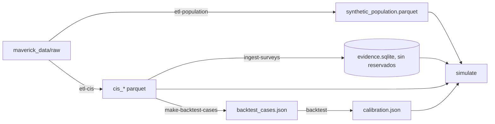
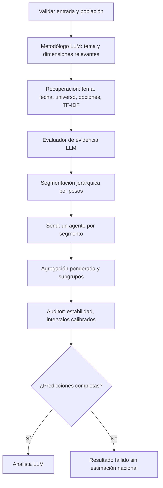

# GenAI Mavericks · población sintética de España con agentes LLM

Simulación distribucional de adultos residentes en España: una población sintética (Fase 1) se segmenta por peso, cada
segmento recibe una estimación anclada en los microdatos reales del CIS y un grafo de LangGraph agrega el resultado
nacional y por subgrupos junto con una estimación de cuánto fiarse. Las ejecuciones con Mock y las fixtures se
identifican como **DEMO / SYNTHETIC** y no tienen validez sociológica.

## Flujo de trabajo



Los datos **no se suben a git**: `maverick_data/` y `data/processed/` están ignorados (solo `catalogo.csv` y
`README.md` de `maverick_data/`). Reglas del reto: ningún dato publicado después del 30/06/2026 y los estudios con
`reservado_examen = si` (publicados desde el 01/04/2026) no se usan para desarrollar ni para el RAG, solo para el
backtest.

## Arranque

Requiere Python 3.11+ y [uv](https://docs.astral.sh/uv/) (`pip install uv`; si hay un error de certificado TLS al
descargar Python, `UV_SYSTEM_CERTS=1`).

```sh
uv sync
uv run pytest -q
uv run ruff check src tests app.py main.py
```

Demo sin datos reales (todo marcado como sintético):

```sh
uv run python main.py create-demo
uv run python main.py simulate --provider mock --question "¿Pagarías por una aplicación con IA?" --options "Sí" "No" "No estoy seguro" --segments 5
uv run streamlit run app.py
```

## Pipeline con datos reales

```sh
# 1. Población (Censo 2021 + Cifras de Población + EPA 2T26 + ECV 2025), n y semilla configurables
uv run python main.py etl-population --n 50000 --seed 42
# 2. Microdatos del CIS -> cis_studies / cis_questions / cis_respondents / cis_responses
uv run python main.py etl-cis
# 3. Evidencia para el RAG (omite los estudios reservados)
uv run python main.py ingest-surveys --path data/processed/cis_questions.parquet
# 4. Simulación
uv run python main.py simulate --provider ollama --model llama3:latest \
  --path data/processed/synthetic_population.parquet --segments 20 \
  --question "Grado de acuerdo con permitir la venta de coches de combustión después de 2035" \
  --options "Muy de acuerdo" "Bastante de acuerdo" "Regular" "Poco de acuerdo" "Nada de acuerdo"
# 5. Backtest con los estudios reservados y calibración de la confianza
uv run python main.py make-backtest-cases
uv run python main.py backtest --provider ollama --model llama3:latest \
  --path data/processed/synthetic_population.parquet --cases data/processed/backtest_cases.json --segments 20
```

El formato de los ficheros está en [docs/phase1-contract.md](docs/phase1-contract.md).

### Comandos

| Comando | Para qué |
|---|---|
| `etl-population` | Población sintética con IPF y categorías del CIS (`--n`, `--seed`, `--period`) |
| `etl-cis` | Convierte los zips del CIS (`--only 3546 3535` para un subconjunto) |
| `ingest-surveys` | Ingesta evidencia (JSON/CSV/Parquet/XLSX/PDF); `--include-reserved` solo para pruebas |
| `simulate` | Simulación; `--segments`, `--anchor off`, `--stability-runs k`, `--calibration` (ruta u `off`), `--rag off` |
| `make-backtest-cases` | Casos desde los estudios reservados (`--mode temporal` o `strict`, `--max-per-study`) |
| `backtest` | Ejecuta los casos, resume MAE/JSD por tema y modo y escribe `calibration.json` |
| `build-segments`, `inspect-population`, `search-evidence`, `survey-stats`, `check-model` | Utilidades |

## Cómo funciona



- **Temas** (`topics.py`): enum cerrado `general, vivienda, salud, ia_tecnologia, consumo, medio_ambiente, soledad`, igual
  que las carpetas de datos. La búsqueda filtra por tema (más `general`) y amplía marcando `topic_fallback` si no hay
  resultados; la pregunta literal siempre se busca sin filtro de tema.
- **Segmentación** (`population.py`): parte de un segmento y divide siempre el de mayor peso por la siguiente dimensión
  (primero las que pide el metodólogo: edad, sexo, estudios, CCAA, hábitat, ingresos). Las celdas pequeñas se agrupan
  en «Otros». Devuelve `--segments` segmentos (≥ 10 personas cada uno).
- **Ancla empírica** (`anchor.py`): para cada segmento se calcula la distribución CIS ponderada de la pregunta con
  contracción jerárquica hacia niveles superiores.
  - Misma pregunta (similitud ≥ 0,90, opciones equivalentes): **estadística directa**, sin LLM por segmento.
  - Pregunta parecida (≥ 0,55): el LLM recibe el prior y su salida se proyecta a ±0,15 de él.
  - Sin pregunta comparable: el LLM usa la evidencia y declara incertidumbre.
- **Subgrupos**: se calculan por composición del segmento y solo se publican las dimensiones que la segmentación
  distingue en ≥ 60 % del peso (`subgroup_resolution`). No se inventan diferencias que la segmentación no resuelve.
- **Fallos del LLM**: los reintentos llevan el error previo y suben la temperatura; el evaluador, el metodólogo y el
  analista tienen alternativa determinista con aviso. Un segmento fallido sigue bloqueando la estimación nacional.
- **Confianza**: `trust_metrics` incluye estabilidad (k repeticiones, JSD), error histórico del backtest, skill frente a
  la distribución uniforme e intervalos (`calibrated_intervals`) por modo de ancla. Sin ≥ 20 casos de backtest se
  mantiene «Fiabilidad predictiva todavía no calibrada».
- **Backtest**: la evidencia debe haber terminado su trabajo de campo antes del inicio del estudio objetivo; modo
  `temporal` (oleadas anteriores permitidas, como en el uso real) o `strict` (texto idéntico excluido).

## LLM

Ollama por defecto (`ollama serve`; `ollama list`). `num_ctx` se fija en 8192 (`OLLAMA_NUM_CTX`); concurrencia 1
(`--concurrency`). `check-model` comprueba que el modelo existe. No hay fallback silencioso a Mock. API externa
compatible con OpenAI: `uv sync --extra external` y variables `EXTERNAL_*`.

Medido en este equipo (RTX 4060 Laptop 8 GB, Ollama, `llama3:latest`, prompt compacto de < 3,5 KB por segmento):
≈ 4-13 s por segmento con prior (estimación: 20 segmentos ≈ 2-4 min; 80 ≈ 8-17 min), y ≈ 0 s por segmento con estadística
directa. `mistral:latest` fue más lento y falló más a menudo. `qwen3:8b` no estaba instalado y no se ha probado.

## Interfaz

```
python -m uv run streamlit run app.py
```

Páginas (en español, sin parámetros técnicos a la vista; todo lo avanzado está en el expander «Avanzado»):

- **Simular** (`app.py`): pregunta, plantillas de opciones (Sí/No, Mucho–Nada, acuerdo 1–5), modo de cálculo, distribución
  con intervalo del 90 %, tarjeta del modo (directo / prior / sin ancla) y nivel de confianza con el error típico del
  backtest, subgrupos (sexo, edad, CCAA, estudios, ingresos) en barras, mapa de calor o tabla, preguntas del CIS usadas y
  descargas CSV/JSON.
- **Lote**: CSV o Excel con `pregunta`, `opciones` (separadas por `|`) y `tipo`; devuelve un Excel con total, subgrupos y evidencia.
- **Validación**: lee `outputs/baseline_v1/backtest.json`: error por modo y tema frente al reparto uniforme y al suelo de ruido,
  cobertura de los intervalos y predicho frente a observado.
- **Metodología** y **Población** (márgenes de los 50 000 adultos frente a los objetivos del INE).

| Modo de cálculo | Necesita GPU/Ollama | Qué hace |
|---|---|---|
| `rapido_sin_llm` | No (≈2 s) | Ancla directa o prior por analogía con datos del CIS |
| `recomendado` | Solo si Ollama está disponible; si no, cae al rápido con un aviso | Estadística + modelo de lenguaje como ajuste |
| `llm_completo` | Sí (Ollama con el modelo configurado) | Pipeline completo con agentes por segmento |

Los ejemplos de la barra lateral están precalculados en `data/examples/ejemplos_demo.json` (modo rápido) para que la demo no
espere; se regeneran con `uv run mavericks build-examples [--preset recomendado]`. Los objetivos del INE de la página de
población se generan una vez con `uv run mavericks population-targets`.

## Estructura

`src/mavericks/`: `etl/` (cis, population), `categories.py`, `topics.py`, `population.py`, `evidence.py`, `anchor.py`,
`payloads.py`, `graph.py`, `llm.py`, `statistics.py`, `evaluation.py`, `backtest_cases.py`, `schemas.py`, `cli.py`.

Más detalle del estado y de lo pendiente en [docs/status.md](docs/status.md).
